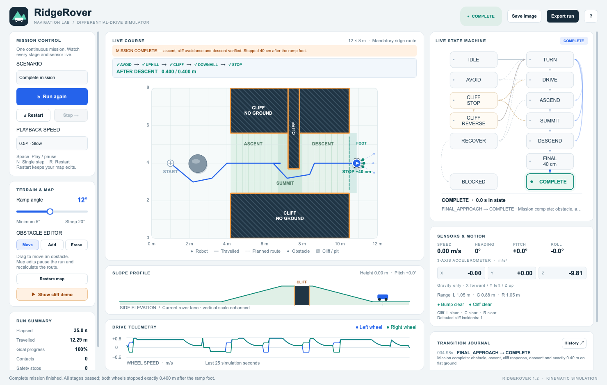

## 工程问题

机器人跑完整条赛道时，单看轨迹很难判断它是提前绕行，还是在感知到危险后才改变动作。RidgeRover 将俯视地图、坡面剖面、轮速、虚拟传感器和当前状态放在同一界面，供使用者暂停、单步和比较不同工况。

## 我的工作

我将差速机器人导航逻辑重新实现为独立的 Python 桌面仿真。使用 Qt 制作交互界面，允许拖动或增删障碍、改变坡度、查看状态转换原因，并将轨迹和事件导出为 CSV 或 JSON。

## 控制方法

A* 根据当前已知地图规划路线，计算时考虑车身轮廓。状态机将路径转化为左右轮速度。默认任务在坡顶保留一处起初未知的缺口，虚拟悬崖传感器检测到它后触发停车、后退、转向与重新规划。独立的几何保护层检查下一步动作是否会进入障碍或悬崖。下坡后以坡底为起点，单独计量最后 0.40 m 的行程。

## 结果与验证

v1.2 的 31 项仿真引擎检查及 12 项界面交互检查均通过。默认工况设为 12° 坡度、随机种子 7，积分步长 20 ms。该次仿真历时 **34.98 秒**，行程 **12.285 m**，记录 1 次传感器触发的悬崖响应，完成下坡后的 **0.400 m** 定距行驶，最终双轮指令为零。打包的 Apple Silicon 应用也走完了该任务。

## 适用范围

结果属于桌面仿真。模型使用简化的差速运动学，传感器信号由场景几何生成，三个加速度通道表示重力在车体坐标系中的分量。预设缺口用于验证检测后的动作流程。实机控制效果见独立的 [Kobuki 项目页](../kobuki-control/)。
